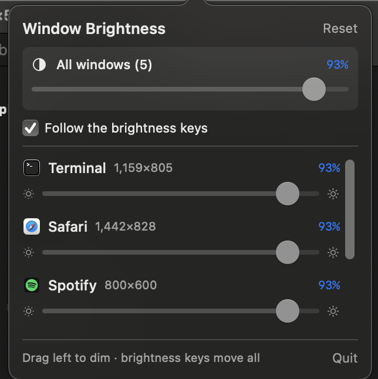

# alpha

Per-window brightness for macOS.

A laptop has one backlight. When a video is too bright at night, turning the
brightness down takes the terminal with it. This dims a single window instead,
and leaves everything else alone.

Built in an evening because I wanted it. It works; it isn't polished.



## Why "alpha"

There is no per-window brightness on macOS, and there can't be — every window is
lit by the same backlight. So nothing here changes brightness at all. It draws a
black rectangle over the target window and varies its **alpha**.

Brightness 40% is black at alpha 0.6. That's the whole idea.

## Build

Needs the Xcode command line tools (`xcode-select --install`). No other
dependencies, no Xcode project, no package manifest.

```sh
git clone https://github.com/Akanshaak/alpha.git
cd alpha
make
make install          # puts the wrapper at ~/bin/dim
```

If you keep the checkout somewhere other than `~/tools/windim`, set
`WINDIM_DIR` to point at it.

## Use

```sh
dim ui          # menu bar panel — a slider per window
dim             # hover a window for 3 seconds, it dims
dim Safari      # dim that app's frontmost window
dim more/less   # nudge the CLI overlay
dim off         # clear everything
```

The panel gives you a slider per window, a master slider across all of them, and
a checkbox to follow the hardware brightness keys so F1/F2 move every window
together. Because the dimming is software, that master keeps going **below** the
backlight's minimum — which is the point, at night.

## How it works

- `CGWindowListCopyWindowInfo` gives every window's id, owner, bounds and layer,
  front to back.
- A borderless `NSWindow` at floating level sits above normal windows with
  `ignoresMouseEvents = true`, so clicks pass straight through.
- Each frame, the target's rectangle minus every window stacked on top of it
  (`CGPath.subtracting`) is filled with black at `1 - brightness`. Only pixels
  you can actually see get darkened.
- A 15 Hz loop reconciles overlay geometry against where the windows actually
  are. Nothing is event-driven; windows don't announce that they moved.
- The brightness keys aren't intercepted. `DisplayServicesGetBrightness` is
  polled and the *delta* applied to every window, which gets the same result
  without touching the event stream.

## Permissions

None. It never prompts.

Window geometry, app names and z-order are readable without Screen Recording —
only window *titles* need it, so the panel lists app name and size instead.
Brightness is read rather than intercepted, so no Accessibility access either.
That was a design constraint, not a happy accident.

## Known rough edges

- Levels reset when the panel restarts. Nothing is persisted yet.
- No `.app` bundle, no login item. It's a bare binary you start yourself.
- Unsigned and not notarised. Build it yourself; don't trust a binary from me.
- Only windows on the same layer can occlude the target. System overlays sit
  higher and are invisible, and treating them as occluders wipes the dim region
  to nothing — which is exactly the bug that ate the first hour.
- External displays aren't handled specially. One backlight is the premise;
  if you have a real second monitor, DDC tools like BetterDisplay are a better fit.

## More

`NOTES.md` is a longer writeup on how this is put together — window levels,
the two coordinate systems, the macOS permission model, and what else the same
handful of APIs is good for.

MIT.
